# Diagramas para informe final - Mechanic Pro

Diagramas basados en el esquema actual del proyecto, principalmente en `server/schema.sql`.

## 1. Modelo Conceptual de Datos MER

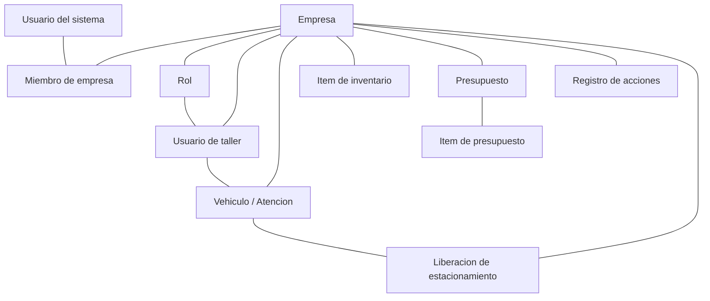

## 2. Modelo Logico de Datos

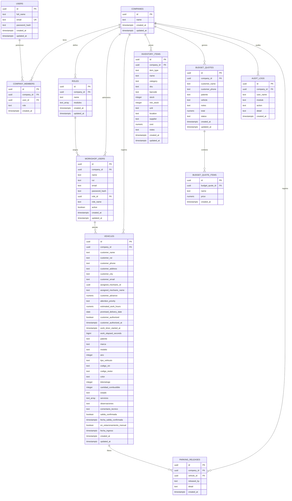

## 3. Diagrama de Clases

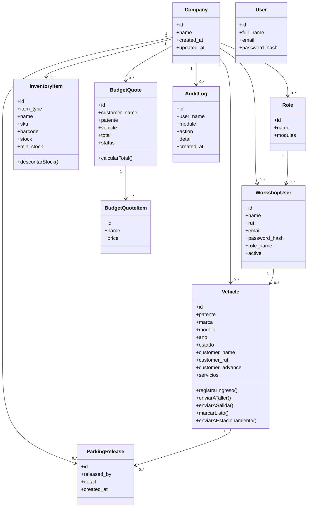

## 4. Diagramas de Secuencia

### 4.1 Inicio de sesion

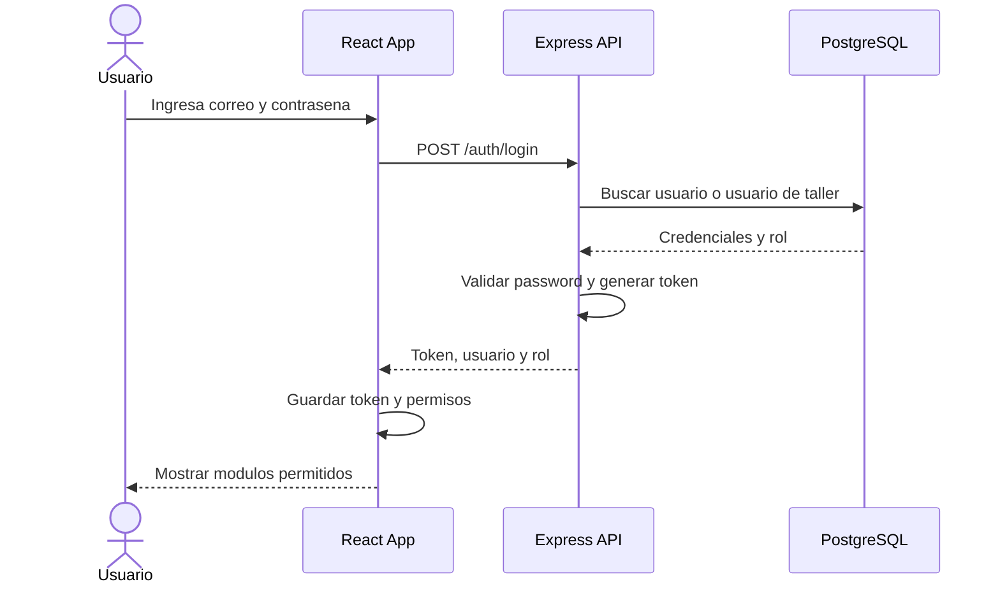

### 4.2 Registro de vehiculo y envio a taller

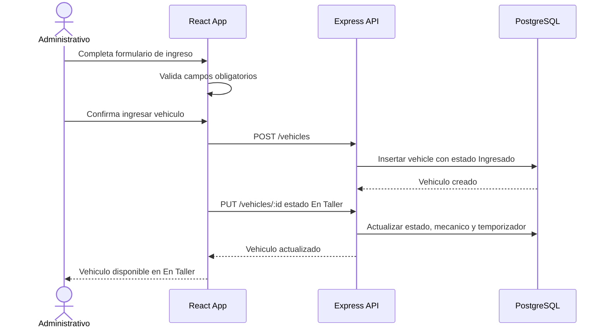

### 4.3 Trabajo en taller, servicios e inventario

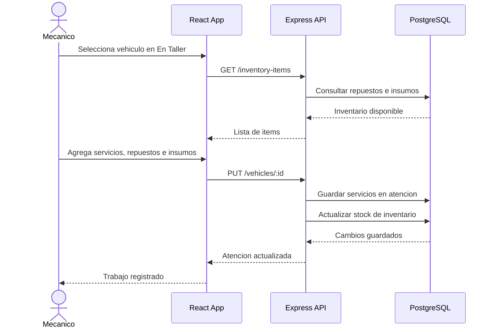

### 4.4 Salida y estacionamiento

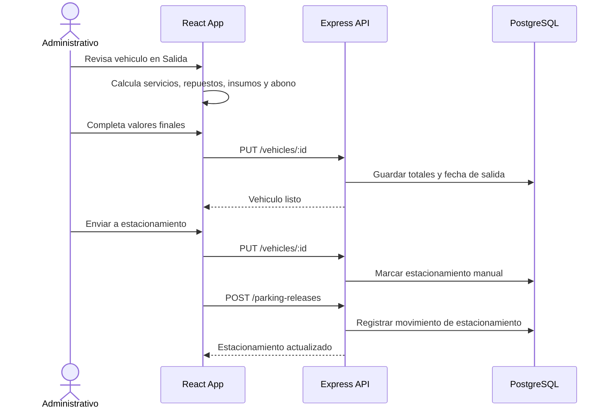

### 4.5 Registro de acciones

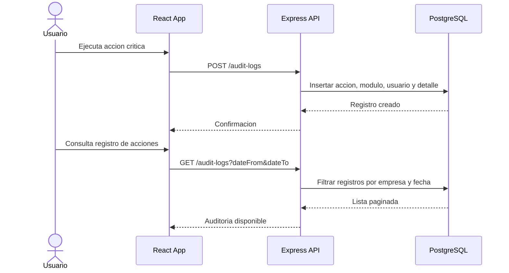

## 5. Diagramas de Colaboracion

### 5.1 Colaboracion: ingreso de vehiculo

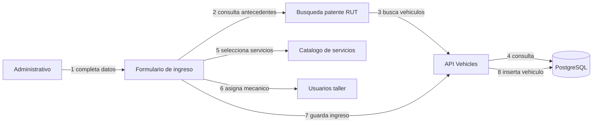

### 5.2 Colaboracion: trabajo en taller

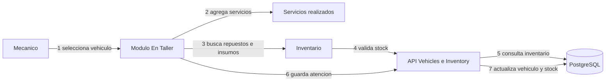

### 5.3 Colaboracion: cierre de atencion

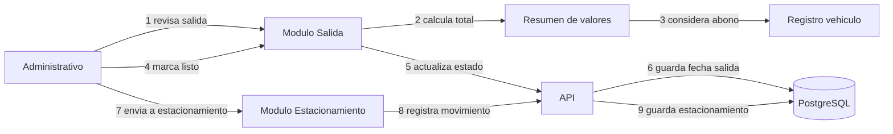

## 6. Diagrama de Arquitectura

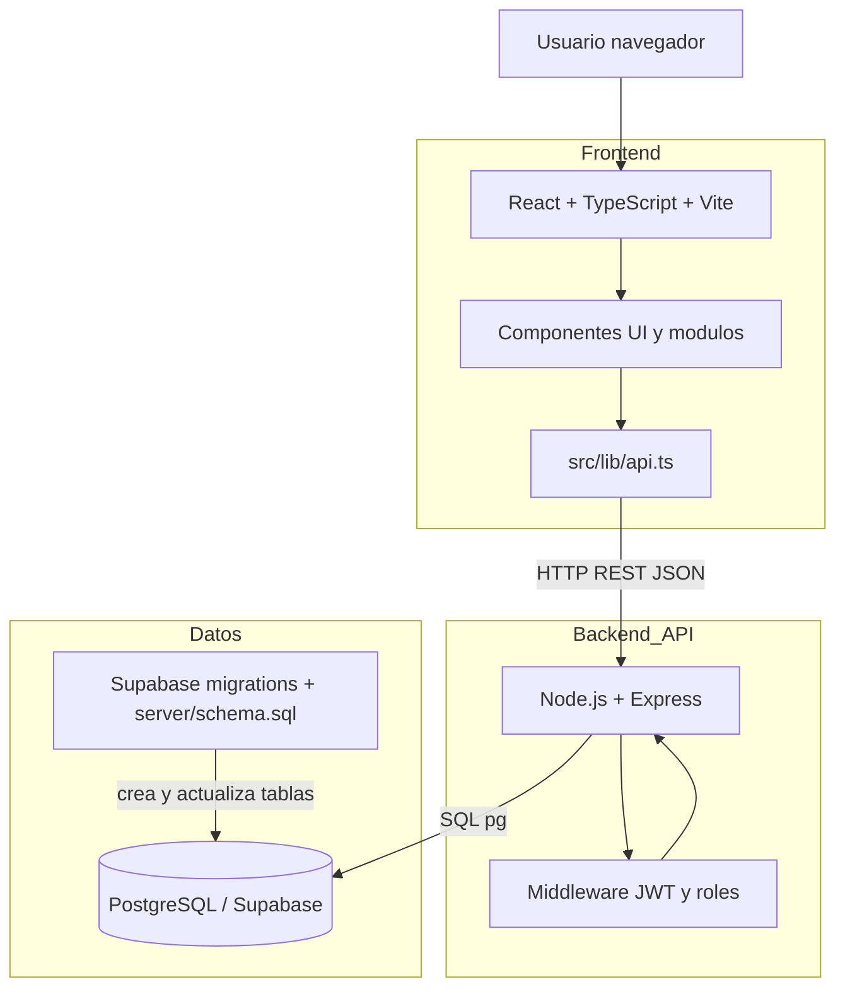

## 7. Arquitectura por capas

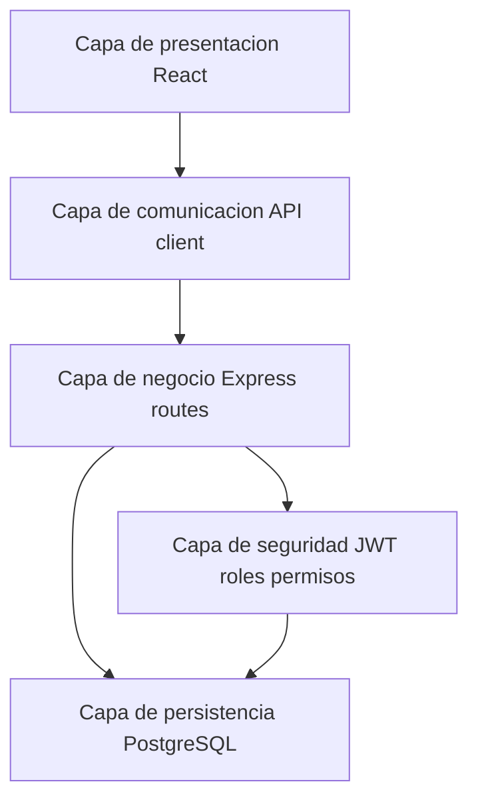

